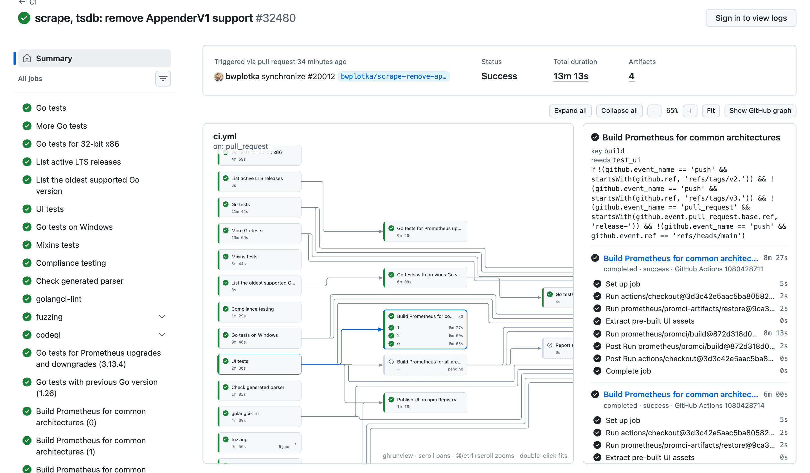

# ghrunview

A nested job-dependency graph for GitHub Actions runs, rendered inside
github.com by a Tampermonkey userscript and backed by a small local server.



GitHub's own run graph shows top-level jobs only. ghrunview draws `needs:`
edges as orthogonal arrows that never cross a box, expands reusable workflows
into nested boxes (recursively, including `owner/repo/...@ref` references),
groups matrix jobs into one box with a row per value, and shows steps and
timings for the selected job. It polls while a run is in progress.

## Install

1. Install the binary and start the server, either as a login service that
   keeps running in the background (see below) or in the foreground. It
   reads your token from `GH_TOKEN`, `GITHUB_TOKEN` or `gh auth token` and
   only listens on loopback.

   ```sh
   go install github.com/perhells/ghrunview@latest
   ghrunview service install      # background, starts at login
   ghrunview -open=false          # or: foreground, this terminal only
   ```

2. With [Tampermonkey](https://www.tampermonkey.net/) installed, open
   <http://127.0.0.1:8788/ghrunview.user.js> and accept the install dialog.

3. Open any `github.com/<owner>/<repo>/actions/runs/<id>` page. The graph
   appears under GitHub's run summary, themed with GitHub's own light and
   dark colours. GitHub's graph is hidden behind a "Show GitHub graph"
   toggle.

The script talks to the server with `GM_xmlhttpRequest`, so GitHub's CSP and
CORS do not get in the way; the server deliberately sets no CORS headers and
rejects non-loopback `Host` headers, so other websites cannot read your runs
through it. The server address is baked in from the URL you installed from
and can be changed from Tampermonkey's menu ("Set ghrunview server URL").

The renderer is bundled through `@require` and, where the userscript sandbox
allows `eval`, refreshed from the server on every page load. After upgrading
and restarting the server, run "Check for userscript updates" in
Tampermonkey (or reinstall from the link) to pick up a new version.

## Run it in the background

So the userscript always finds a server, install it as a per-user service
(launchd on macOS, `systemd --user` on Linux). It starts at login, restarts
if it dies, and logs to `~/Library/Logs/ghrunview.log` or the user journal.
Nothing is installed unless you run this yourself.

```sh
ghrunview service install             # default 127.0.0.1:8788
ghrunview service install -addr 127.0.0.1:9000
ghrunview service status
ghrunview service uninstall
```

The service runs the binary it was installed from, so after `go install`
run `service install` again to pick up the new build. Token lookup via
`gh auth token` works under the service because the directory of `gh` is
added to its PATH; alternatively set `GH_TOKEN` in the generated plist or
unit.

## Using the graph

- Reusable-workflow boxes start collapsed; click to expand, click again to
  collapse. "Expand all" / "Collapse all" re-fit the view.
- Hover highlights a box's edges and neighbours; the selected box and its
  edges are blue; truncated labels expand after a short hover.
- Scroll pans, ctrl/⌘+scroll or pinch zooms around the cursor, drag pans,
  double-click on empty canvas fits. The view auto-fits after every
  expand/collapse until you pan or zoom by hand.
- The side panel lists jobs with runner, steps and durations and links to
  the logs on GitHub.

## Standalone page

The server also serves the same UI at <http://127.0.0.1:8788/>: a run list
with branch/status/event/workflow filters and the run view. Any repository
can be opened from the input in the top bar; the URL hash carries it
(`#/owner/repo`, `#/owner/repo/run/<id>`, `?expand` opens every group).

```sh
cd some/repo && ghrunview          # repo from `git remote get-url origin`
ghrunview -repo octocat/hello-world
ghrunview -addr 127.0.0.1:9000 -open=false
ghrunview -dev                     # serve web/ from disk while developing
```

## How the graph is built

1. `GET /actions/runs/{id}` and `/jobs` from the GitHub REST API.
2. The workflow file at the run's `head_sha` is fetched and parsed for `jobs`,
   `needs`, `strategy.matrix`, `if` and `uses`.
3. API job names (`Caller / Inner (matrix) / Leaf`) are matched back to the
   definitions; `uses:` targets (`./.github/...` and `owner/repo/path@ref`)
   are fetched recursively so nested reusable workflows get their own
   sub-DAG, and calls that wrap a single job are flattened into it.
4. Jobs that cannot be matched are still shown, grouped by name, without
   edges. Dependabot, Pages and default-setup CodeQL runs have no workflow
   file and show their jobs without edges.

Workflow files are cached per `sha` in memory for the lifetime of the
process.

## Layout

```
main.go                 flags, token, embedded UI, browser open
internal/gh             REST client (runs, jobs, raw file contents)
internal/workflow       YAML -> job definitions
internal/graph          match API jobs to definitions, nest reusable workflows
internal/server         /api/config, /api/runs, /api/runs/{id}, /ghrunview.user.js, static UI
internal/service        launchd / systemd user service install, uninstall, status
web/graph.js            shared renderer (layout, routing, SVG, hover/select, side panel)
web/app.js              standalone page: routing, run list, run header
web/userscript.js       Tampermonkey shim; served with a generated header
```

## Limits

- github.com only; GitHub Enterprise hosts are not supported.
- `pull_request_target` and `workflow_run` runs execute the base-branch
  workflow file, but ghrunview reads the file at `head_sha`, so definitions
  can differ.
- Matrix values containing `)` or job names containing ` / ` can mis-match.
